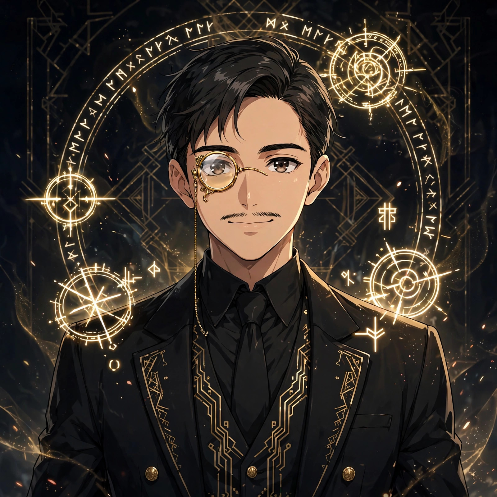
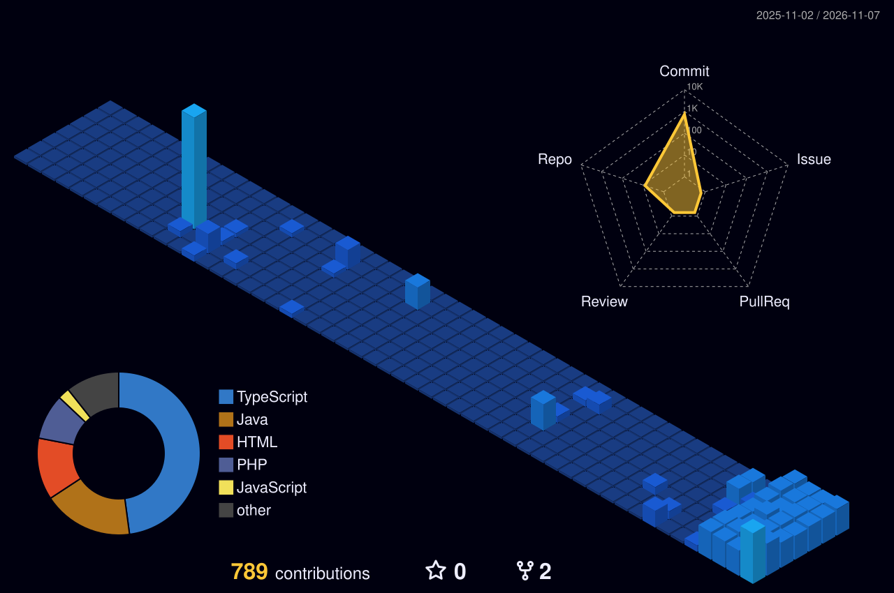

<!-- HERO -->

  

  

 

  <b>God of Error arc</b> · inspired by Amon from <i>Lord of the Mysteries</i> · monocle on, bugs beware

  I am a <b>full-stack developer</b> who builds <b>scalable, practical, and efficient web applications</b>. Like Amon, I look at every error as a door, not a dead end. 
  My portfolio: <b><a href="https://saurabshrestha.com.np">saurabshrestha.com.np</a></b>

 

<!-- MY ERROR WAY -->

  

<!-- ERROR ARSENAL -->

  

<!-- ERROR REGISTRATION + LIVE STATS -->

 

 

  

## S-Rank Missions

<table>
<tr><th>Mission</th><th>What it is</th><th>Error arts used</th><th align="center">Stars</th></tr>
<tr><td><a href="https://github.com/saurav73/ToolNest"><b>ToolNest</b></a></td><td>Free online tools: PDF, image, QR, text and developer utilities, free, no sign-up, runs in your browser (currently my main focus) · <a href="https://toolnest-sage.vercel.app">live site</a></td><td><code>React</code> <code>JavaScript</code></td><td align="center"></td></tr>
<tr><td><a href="https://github.com/saurav73/GrihaMate"><b>GrihaMate</b></a></td><td>Connects room seekers with landlords and their available rooms, with AI property search</td><td><code>React</code> <code>TypeScript</code> <code>Spring Boot</code></td><td align="center"></td></tr>
<tr><td><a href="https://github.com/saurav73/BookBridge"><b>BookBridge</b></a></td><td>Book exchange for students: buy, sell and exchange second-hand books, with real-time chat</td><td><code>Java</code> <code>Spring Boot</code> <code>WebSocket</code></td><td align="center"></td></tr>
<tr><td><a href="https://github.com/saurav73/KavyaSetu"><b>Poem Sansar</b></a></td><td>Poem sharing (KavyaSetu): poets publish poems, keep drafts private, browse the public feed</td><td><code>PHP</code> <code>Laravel</code></td><td align="center"></td></tr>
</table>

 

### My contribution village

*Every commit raises another building, rebuilt automatically every day.*

  

<!-- JOIN THE ERROR PATHWAY -->

  

  

### Daily Dev Quote

 

 

**The error was never the end.**

<!-- Maintainer note: profile contents are Amon banner hero, chibi dance GIF, Amon avatar, typing line, About, Error Way, Error Arsenal, Error Registration + live stats, four S-Rank Missions (ToolNest, GrihaMate, BookBridge, Poem Sansar/KavyaSetu), 3D contribution village, Connect badges, visitor counter, Daily Dev Quote, chibi walk GIF, sign-off. S-Rank Missions are those four only; no Content Creation section; calculator projects never shown. -->
