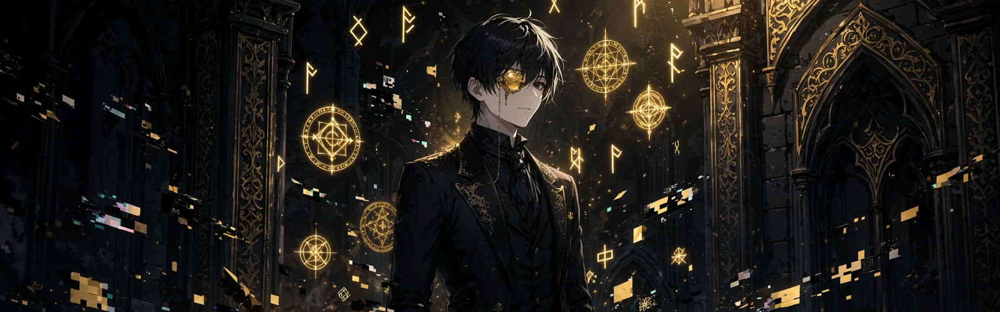

  

<h1 align="center">Saurav Shrestha</h1>

  

  <b>God of Error arc</b> · inspired by Amon from <i>Lord of the Mysteries</i> · monocle on, bugs beware

---

## 🧐 About Me

Hi there!  
I’m a **full-stack developer** passionate about building **scalable, practical, and efficient web applications**. Like Amon, I look at every error as a door, not a dead end.
🌐 My portfolio: **[saurabshrestha.com.np](https://saurabshrestha.com.np)**
I mainly work with **Java Spring Boot, React.js, and MySQL**, focusing on **clean architecture, backend development, and system design**.

I enjoy solving **real-world problems**, experimenting with **AI integration**, and exploring **modern web technologies**.
Always learning, building, and improving through hands-on projects.

---

## 🛠️ Tech Stack

  
  
  
  
  
  
  
  

---

## 📊 The Error Log (GitHub Stats)

  
  

  

---

## 🚀 Featured Projects

| Project | Live link | What it is |
|---|---|---|
| **ToolNest** | [toolnest-sage.vercel.app](https://toolnest-sage.vercel.app) · [source](https://github.com/saurav73/ToolNest) | Free online tools: PDF, image, QR, text and developer utilities — free, no sign-up, runs in your browser (currently my main focus) |

---

## 🌐 Connect with Me

  
  
  
  

---

### ✍️ Daily Dev Quote

  

---

<!-- Maintainer note: profile contents are Amon banner, About, Tech Stack, GitHub Stats, one Featured Project (ToolNest), four Connect links (LinkedIn, Instagram, GitHub, TikTok), and a Daily Dev Quote widget. Featured Projects stays ToolNest-only; no Content Creation section. -->
