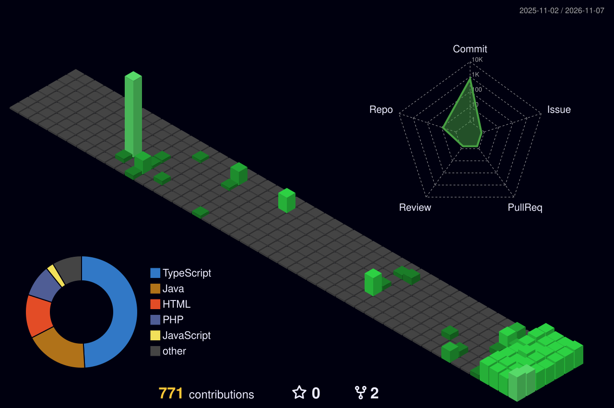

<!-- HERO -->

 

  <b>The Fool arc</b> · Klein Moretti from <i>Lord of the Mysteries</i> · Sefirah Castle, gray fog beware

  I am a <b>full-stack developer</b> who builds <b>scalable, practical, and efficient web applications</b>. Like Klein, I look at every mystery as a door, not a dead end. 
  My portfolio: <b><a href="https://saurabshrestha.com.np">saurabshrestha.com.np</a></b>

 

<!-- MY FOOL'S WAY -->

  

<!-- FOOL'S ARSENAL -->

  

<!-- FOOL'S REGISTRATION (ID BADGE) -->

 

 

  

## S-Rank Missions

<table>
<tr><th>Mission</th><th>What it is</th><th>Fool's arts used</th><th align="center">Stars</th></tr>
<tr><td><a href="https://github.com/saurav73/ToolNest"><b>ToolNest</b></a></td><td>Free online tools: PDF, image, QR, text and developer utilities, free, no sign-up, runs in your browser (currently my main focus) · <a href="https://toolnest-sage.vercel.app">live site</a></td><td><code>React</code> <code>JavaScript</code></td><td align="center"></td></tr>
<tr><td><a href="https://github.com/saurav73/GrihaMate"><b>GrihaMate</b></a></td><td>Connects room seekers with landlords and their available rooms, with AI property search</td><td><code>React</code> <code>TypeScript</code> <code>Spring Boot</code></td><td align="center"></td></tr>
<tr><td><a href="https://github.com/saurav73/BookBridge"><b>BookBridge</b></a></td><td>Book exchange for students: buy, sell and exchange second-hand books, with real-time chat</td><td><code>Java</code> <code>Spring Boot</code> <code>WebSocket</code></td><td align="center"></td></tr>
<tr><td><a href="https://github.com/saurav73/KavyaSetu"><b>Poem Sansar</b></a></td><td>Poem sharing (KavyaSetu): poets publish poems, keep drafts private, browse the public feed</td><td><code>PHP</code> <code>Laravel</code></td><td align="center"></td></tr>
</table>

 

### My contribution village

*Every commit raises another building, rebuilt automatically every day.*

  

<!-- JOIN THE FOOL'S PATHWAY -->

  

  

### Daily Dev Quote

 

 

**The Fool was never the end.**

<!-- Maintainer note: profile contents are a live hero served from profile-hero-saurav73s-projects.vercel.app/api/hero (template assets/hero-template.svg; the endpoint draws repos and followers fresh from the GitHub API on every view and fills them into the hero chips, so the numbers are never baked in and nobody updates them), About, Fool's Way, Tech Orbit (stack.svg), the Fool tarot card (tarot-fool.jpg), live stats, four S-Rank Missions (ToolNest, GrihaMate, BookBridge, Poem Sansar/KavyaSetu), 3D contribution village, Connect footer (connect.svg), Connect badges, visitor counter, Daily Dev Quote, chibi walk GIF, sign-off. THEME: dark ancient, like the Fool tarot card — near-black warm brown backgrounds, antique gold, parchment text, crimson danger accents; every custom SVG is dark-only (no light mode, no prefers-color-scheme); the stats, streak, quote and village are dark third-party images. S-Rank Missions are those four only; no Content Creation section; calculator projects never shown. -->
